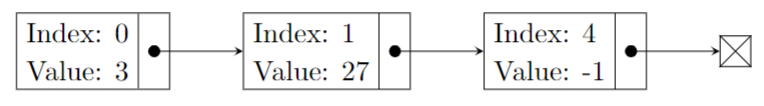
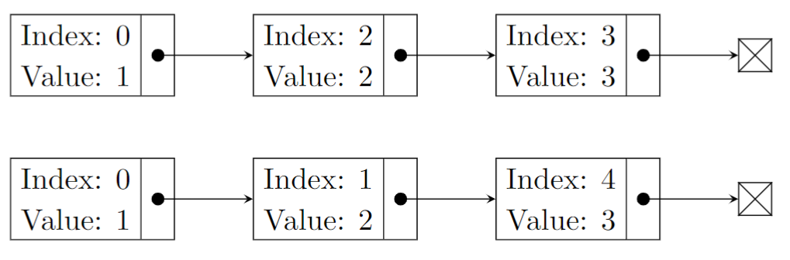

# CSCI 1933 Lab 08: Linked Lists

By now, you should be quite comfortable working with array data structures. In this lab, we will introduce you to a different data structure: linked lists. Depending on the application, you'll find that arrays are more suitable in some cases, while linked lists are better in others.

In this lab, you will be representing a sparse vector using linked lists. A vector is a one-dimensional array of elements. When doing linear algebra operations (e.g. addition, cross product, dot product) in code, it’s common to use an array. Sometimes, a large amount of the elements in a vector are zero. In those cases, we call them sparse vectors. It is a big waste of computational resources to not only store the surplus of zeros, but use them in linear algebra operations.

Let's begin!

```bash
git pull
```
*Note: In the terminal, navigate to the top of the `CSCI-1933-Student-Code` directory using the `cd` command.*

## Milestone 1

### Sparse Vector Representation

Before you begin, the Node class provided has an index attribute that you will be using. You will see other Node classes in future labs and project 3. **Please note, not all Node classes you will see in the future have this index instance variable**.

It’s important to note the length of a vector is separate from the number of nodes it has. The nodes in the linked list represent only the non-zero elements of the vector, while the indices that are not represented by nodes are implied to be zero elements. For example, the diagram shows a sparse vector that has a length of five that only has three non-zero elements:



If you printed out the sparse vector above, it would look like this:

```math
  \begin{bmatrix} 
    3 & 27 & 0 & 0 & -1
  \end{bmatrix}
```

Take a look at the **Node.java** and **SparseVector.java**. Some of the methods have already been implemented for you.

### Milestone 1 Checkoff

> Inspect how the `toString()` for the SparseVector class works. Knowing that the linked list only has nodes representing the non-zero elements of the vector, explain to a TA how the `toString()` manages to print the elements of the linked list and also print the zero elements for indices that don't have nodes in the list.
>
> Note: Your explanation should capture the main points of how the method works without being a line-by-line walkthrough of the code. If you have questions on how to pare down your explanation, call a TA over and they'll be happy to discuss with you!

## Milestone 2

Implement the `addElement()` method.

- For now, assume that `addElement()` is valid for increasingly larger indices. That is, every time you add a node to a SparseVector, it will be added to the end of the linked list as long as it doesn't exceed the size of the list.
- Before you add an element, alert the user if they've tried to add an element incorrectly. You only need to check that it doesn't exceed the length of the SparseVector.

After you implement `addElement()`, run the following code:

```Java
SparseVector vec = new SparseVector(9);
vec.addElement(1, 25.0);
vec.addElement(7, -11.2);
vec.addElement(8, 32.0);
System.out.println(vec);
```

This should be the vector that it prints out:

0, 25.0, 0, 0, 0, 0, 0, -11.2, 32.0

### Milestone 2 Checkoff

> Show a TA your `addElement()` and answer the following questions: What happens if you add another element at index 1? What about index 10?

## Milestone 3

Now that we can create sparse vectors, let’s do some linear algebra. The dot product of two vectors consists of multiplying the entries of the same indices from both vectors, and summing all those products together to get the result. Therefore it follows that both vectors must be the same length for the dot product to be valid. For example, if `x = [a, b, c]` and `y = [d, e, f]`, then `x · y = a * d + b * e + c * f`.

If your vector was stored in an array, it would look like this:

```Java
int result = 0;
for (int i = 0; i < a.length; i++) {
    result += a[i] * b[i];
}
```

Implement this method in your SparseVector class:

`public static double dot(SparseVector x, SparseVector y)`

- Check that the lengths of the two vectors are equal and neither are empty.
- Suppose `x = [1 0 2 3 0]` and `y = [1 2 0 0 3]`. As linked lists, they would look like the image below:



- You will want to use a while loop to traverse through the two linked lists. In addition, you will want pointers keeping track of your current location in each list (ptrX and ptrY for example). There are three cases. (1) The nodes at each pointer have equal indices. You'll then want to multiply their values and add this to the result. Then, move both of those pointers forward. (2)  The index of ptrX is less than the index of ptrY. Don't add anything to the result, and move only ptrX forward. (3) The index of ptrY is less than the index of ptrX. Don't add anything to the result, and move only ptrY forward.
- With the code you write, try simple, easy test cases. First, try `x = [1]` and `y = [2]`. Then try `x = [1 0]` and `y = [0 1]`. You can then progressively add more elements to the vectors.

Once `dot()` is working, run this code:

```Java
SparseVector x = new SparseVector(100001);
x.addElement(0, 1.0);
x.addElement(10000, 3.0);
x.addElement(10001, -2.0);
SparseVector y = new SparseVector(100001);
y.addElement(0, 2.0);
y.addElement(10001, -4.0);
double result = dot(x, y);
System.out.println(result);
```

And the output should be 10.0.

### Milestone 3 Checkoff

> Show a TA your `dot()` code and run the above code. Answer the following questions:
>
> What happens if you take the dot product of vectors that have different lengths?
> What happens if one of the vectors is empty?
