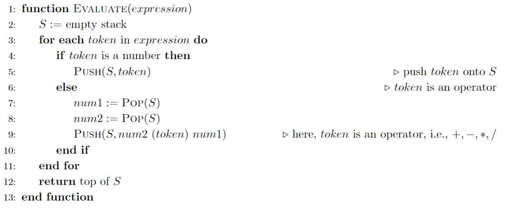

# CSCI 1933 Lab 10: Stacks and Exceptions

## JUnit Tests

This lab included JUnit tests like those you have seen in Projects 2 and 3. They are contained within the Lab10Tests.java file. It is strongly recommended that you use IntelliJ to run these tests. Don’t forget to import JUnit by placing your cursor on the red text in the import statement at the top of the test file and using either Option+Enter (macOS) or Alt+Enter (Windows/Linux) to bring up the option to import JUnit 4. If you don’t see the full import statements, you may have to expand them by clicking on the three dots next to import.

## Important Note

The JUnit tests make some assumptions that determine whether your code will pass a test case or not.

- `evaluate()` — This method should return 0.0 when a postfix expression cannot be evaluated. It also assumes that the default Stack size is used in the Stack.
- `Stack` — The Stack test assumes that you have made a constructor that takes in an integer, size, as a parameter. It also assumes `pop()` and `push()` throw StackException.
- In general, you should make sure that you use the exact method and class declarations to ensure that the tests function properly. Ask for help if you run into any issues related to these tests.

Let's begin!

```bash
git pull
```
*Note: In the terminal, navigate to the top of the `CSCI-1933-Student-Code` directory using the `cd` command.*

## Milestone 1

### Exceptions

In this lab, you will be experimenting with try, catch, and finally statements. Exceptions are used in a program to signal that some error or exceptional situation has occurred and that it doesn’t make sense to continue the program flow until the exception has been handled.

In Java, exceptions are all objects. An exception can be created like any other object, for example, RuntimeException `e = new RuntimeException("Stack is empty!")`. This exception can then be thrown by using the throw e command.

When an exception is thrown, functions on the call stack will fail one at a time until a `catch(RuntimeException e)` statement is encountered or the main method is reached, and the program crashes. While crashing programs is generally bad, smart use of exceptions can force programmers to handle them and thus avoid errors.

`catch(ExceptionType e)` statements have the property that they will catch any exceptions that are of the type ExceptionType or a subclass of that type. Thus `catch(Exception e)` catches everything since Exception is the base class of all exceptions. Specifying the specific type of exception can be useful, however, in cases where different exceptions should lead to different catch blocks.

finally statements have the property that they will always execute, even after an exception is
caught.

Now, it's time to create an exception of your own. In the StackException.java file, your StackException class should inherit from Exception. Thus, your class declaration should be `public class StackException extends Exception {}`. You should have the following methods and instance variables:

- `private int size` — The size of the stack at the time the exception is thrown.
- `public StackException(int size)` — This is the constructor that will set the variable that keeps track of the size of the stack.
- `public int getSize()` —  This method returns the size of the stack. This will help handle exceptions by determining the size of the stack at the time the exception was thrown.

To throw a StackException, you can use the following code:

```Java
throw new StackException(curSize);
```

### Milestone 1 Checkoff

> After you've imported JUnit 4, you can run Lab10Tests.java. You'll see some of the tests commented out for now. Show a TA your StackException class.

## Milestone 2

A stack is an abstract data type that has a "last-in, first-out" structure for data or objects. Your goal is to implement a *generic* stack data structure. This means you have control over the type of objects stored on the stack.

Begin by creating a Stack class with the declaration `public class Stack<T> {}`. This will allow you to make arrays of generic objects. The Stack class should have the following methods:

- `public Stack()` — The default constructor that should set the maximum size of the Stack to be 5.
- `public Stack(int size)` — This constructor initializes the maximum size to be the size that is passed in.
- `public T pop() throws StackException` — This removes and returns the object at the top of the stack, and throws StackException if it is empty.
- `public void push(T data) throws StackException` — This adds an element to the top of the stack if there is space, and throws StackException otherwise.

You can implement your stack using an array or linked list. A linked list is likely easier, and you can use the Node class provided on Canvas. If you wish, you can use an array as long as everything still works properly. Here is how you could initialize a generic node for your stack where the data is of type T:

```Java
Node<T> node = new Node<T>(data, null);
```

We recommend having an instance variable `Node<T> top` that is a pointer to the top of the Stack. At initialization, this will be null. You need a variable `int size` that will keep track of the maximum number of elements in the Stack. In addition, you need a variable `int curSize` that tracks the number of elements in the Stack.

HINT: A simple way to implement a stack as a linked list is to add and remove it from the front of the list. This means you don't need to iterate through the entire list when pushing and popping, or that you don't need an additional pointer for the last node in the list. Be mindful of edge cases such as adding to an empty stack and removing from a stack with a current size of one.

The following is an example of creating a stack, pushing elements onto a stack, popping elements off of the stack, and handling exceptions. The following is an example. You still need to pass the JUnit tests.

```Java
Stack<Integer> myStack = new Stack<>();

try {
    myStack.push(10);
    myStack.push(20);
    myStack.push(30);
    System.out.println(myStack.pop()); // this should print 30
    myStack.push(40);
    myStack.push(50);
    myStack.push(60);
    myStack.push(70); // this causes an exception!
} catch (StackException e) { // catches any StackException that is thrown
    System.out.println("Stack exception has occurred!");
} finally {
    System.out.println("Goodbye!");
}
```

### Milestone 2 Checkoff

> Comment back in the tests for Milestone 2 and run it. Show a TA your Stack class, and tell them what underlying data structure you used.

## Milestone 3

### Applying Stacks — Postfix Expressions

In the past, you've seen mathematical expressions written with infix notation. Postfix notation is a different way to write mathematical expressions that don't need parenthesis or a defined order of operations. Here are some examples of expressions in infix and postfix notation:

| Infix | Postfix |
| :--- | :--- |
| 5 + 2 | {"5", "2", "+"} |
| 1 - 2 | {1, 2, "-"} |
| 3 + (4 * 5) | {"4", "5", "*", *3*, "+"} |
| (1 + 2)/(3 + 4) | {"1", "2", "+", "3", "4", "+", "/"} |

In the Postfix class, complete the `public static double evaluate()` method that takes in an array of Strings, like the examples above, and returns the result of the expression. Here is some pseudocode for the algorithm you will write in `evaluate()`:



A few things to note:

- Once you write the pseudocode, you will see that you are unable to run it due to an "unhandled exception". This is because `pop()` and `push()` throw StackException. This is where the `try`, `catch`, and `finally` blocks that you read about earlier come in. Inside your evaluate method:

```Java
try {
    // your code goes here
} catch(Exception e) {
    // handle the exception - maybe a print statement!
} finally {
    // this will always execute
}
```

- Since the tokens you are iterating through are Strings, the stack should be of Strings.
- Use the default constructor when you initialize the stack, so it creates a stack with a capacity of 5.
- When you're checking if the token is a number, a simple way could just be checking that the string is not equal to "+", "-", "*", or "/".
- When you pop items on the stack and need to perform a mathematical operation on them, you must convert it from a String to a double. Recall, that you can use `Double.parseDouble(String s)`.
- If you need to push something onto the stack, remember, it must be a String. If you are converting a double to a String, you can use `Double.toString(Double d)`.

### Milestone 3 Checkoff

> Comment in the tests for Milestone 3. Show a TA your Postfix class.

### Milestone 4: Min Stacks

Finding the minimum value of a stack is naively an O(n) operation in which the full stack must be searched (unstacked then restacked), similar to finding the minimum of a list. 

For this milestone, implement the `getMinimum()` method in Stack.java using the described approach above.

Implement the following method:
```Java
public T getMinimum();
```

### Milestone 4:
> Implement your minimum stack and modify the given `main()` method to display the minimum functionality. Once you've finished, talk to your TA and walk them through how your implementation solves finding the minimum value.

### Constant Time Minimum (Optional)

Now that that you've familiarized yourself with this approach, let's discuss how we can improve on the runtime. With a tradeoff for additional space complexity, it's possible to retrieve a minimum or maximum value of a stack in O(1) time. Add an instance variable `minimum` to your stack class and the `getMinimumConstant()` method which returns this value directly. Consider carefully where you may need to make changes to support this functionality. 

```Java
private T minimum;

public T getMinimumConstant(){
  return minimum;
}
```


<details>
<summary><h2>Hint 1 (Click me!)</h2></summary>
  <p>Consider what happens when you remove the current minimum element - your program needs to be able to retrieve the previous value to update the minimum.</p>
<details>
<summary><h2>Hint 2 (Click me!)</h2></summary>
  <p>You may want to consider keeping a separate storage of minimum values, perhaps another linked list? Add an instance variable "minimums" to track minimum values as you add and remove elements from your stack. </p>
<details>
<summary><h2>Hint 3 (Click me!)</h2></summary>
  <p>Take a look at your push and pop methods - if you're addding or removing a minimum from your stack, you'll need to do some additional management of your minimum storage. </p>
</details>
</details>
</details>


### Optional Final Check-In:
> Implement your minimum stack and modify the given `main()` method to display the minimum functionality. Once you've finished, talk to your TA and walk them through your implementation. If you used a single stack, talk to them about how a two stack solution may be implemented. If you used an additional instance, discuss how you may solve this problem using a single stack. 
