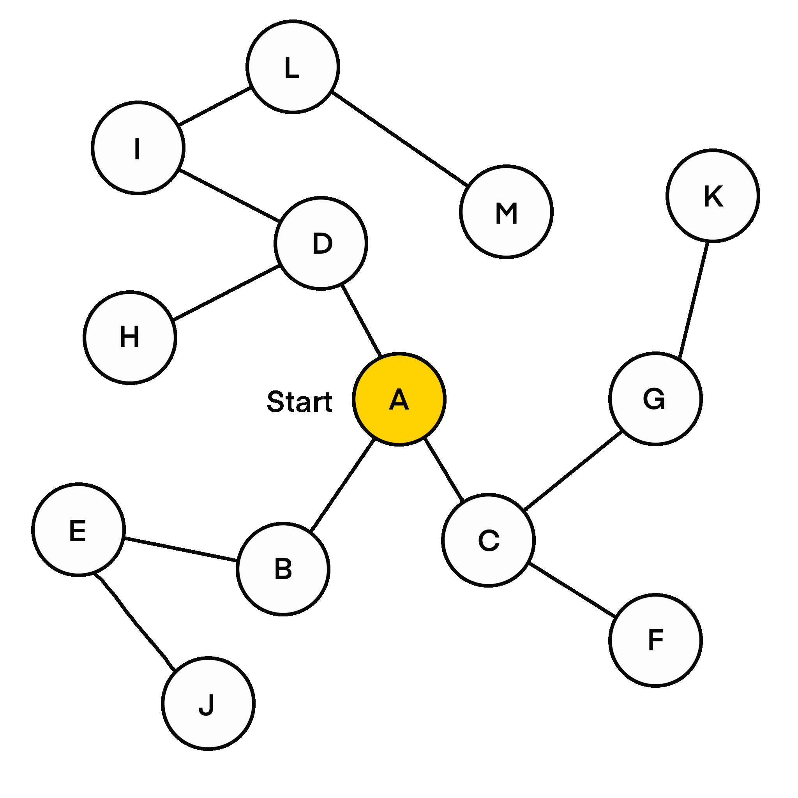
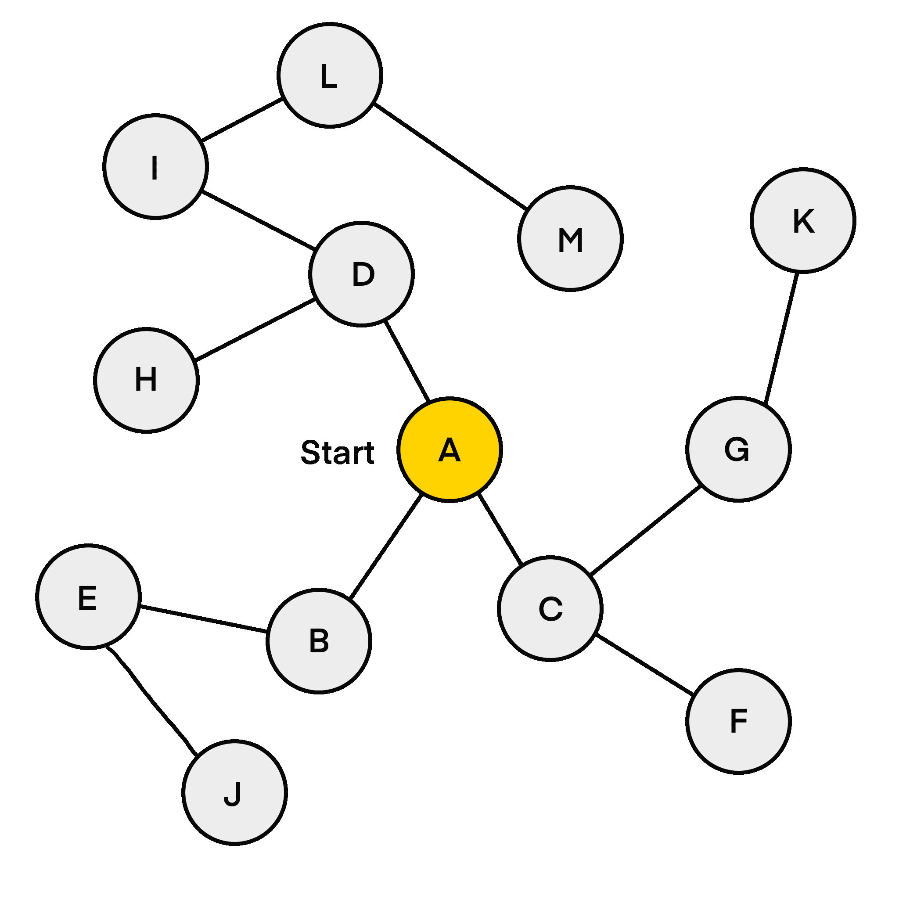
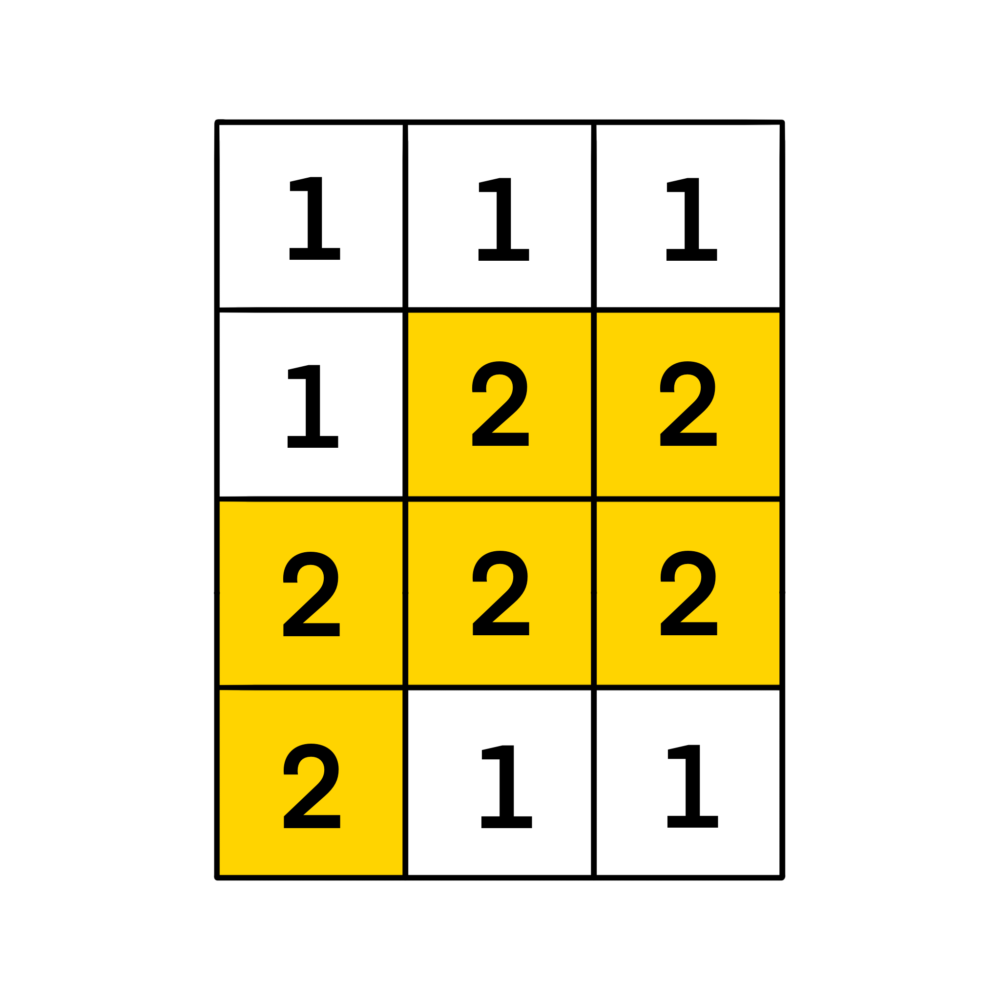
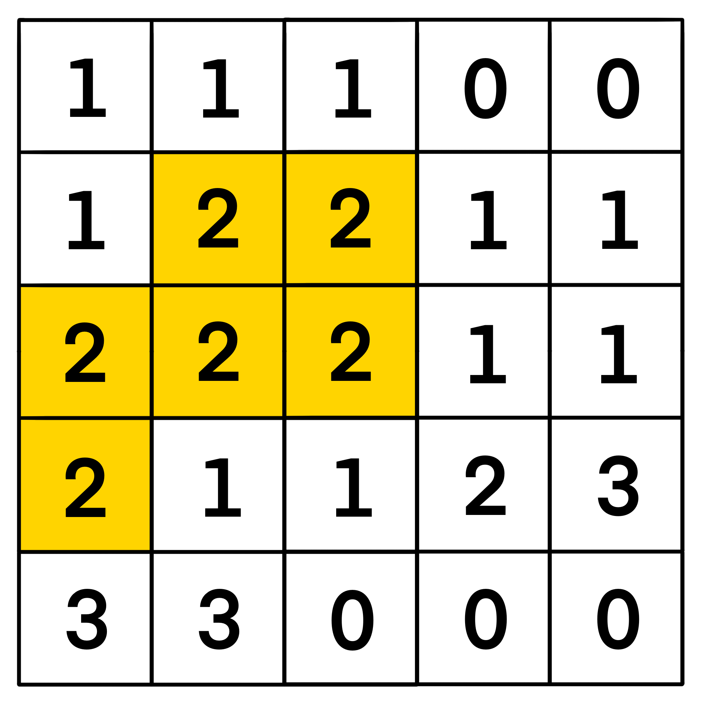
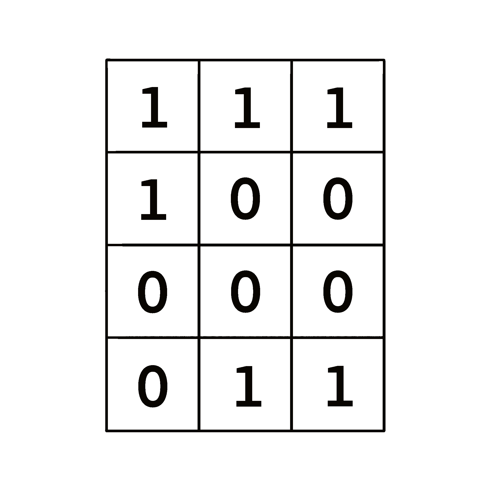
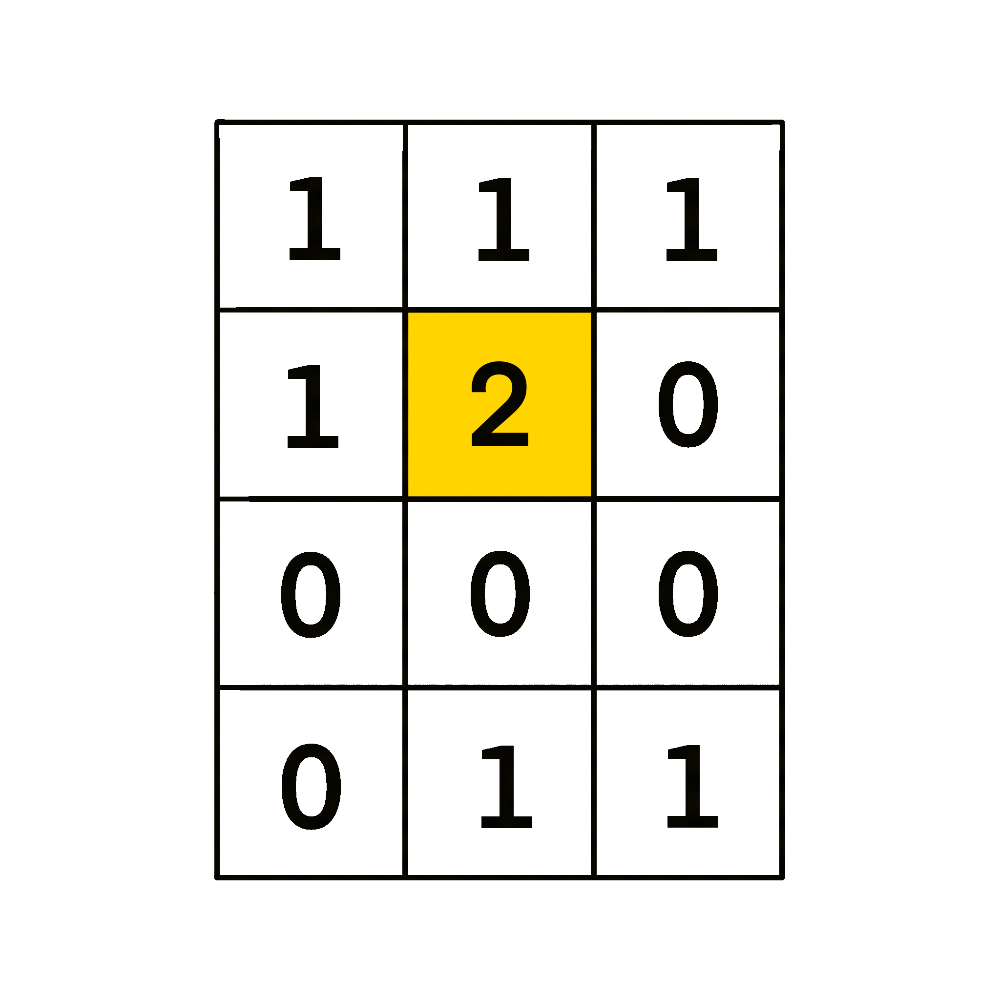
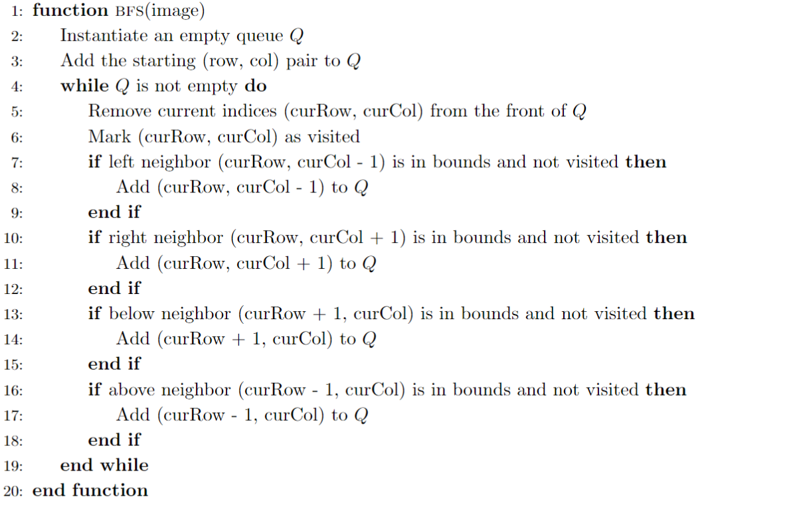
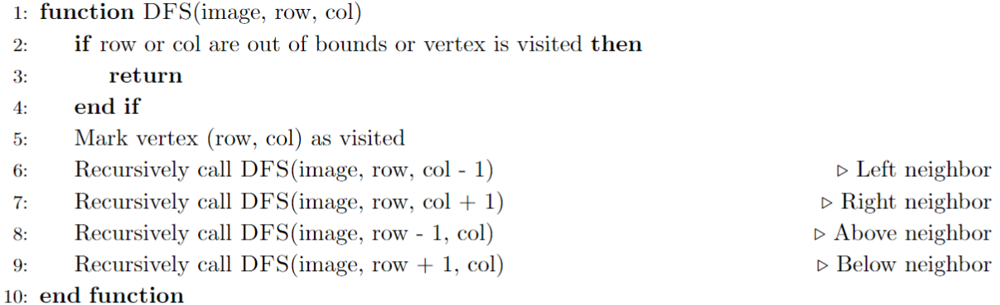

# CSCI 1933 Lab 11: Search Algorithms

Welcome to Lab 11! We will be exploring two widely used search algorithms: Breadth-First Search (BFS) and Depth-First Search (DFS). These algorithms are most typically applied to graphs or trees.

Begin by pulling the files for this lab:

```bash
git pull
```
*Note: In the terminal, navigate to the top of the `CSCI-1933-Student-Code` directory using the `cd` command.*

## Breadth-First Search (BFS)

Breadth-First Search, or BFS, starts at a vertex (or node) and then searches outwards level by level visiting each reachable vertex on each iteration.



## Depth-First Search (DFS)

Depth-First Search, or DFS, starts at a vertex and then traverses as far as possible in one direction. Once the algorithm can no longer continue on the current path, it "backtracks" to the most recent node with unexplored paths and continues the process until all reachable vertices have been visited.



There are some scenarios where you might want to use a BFS (ex. finding connected components) and some scenarios where you might want to use a DFS instead (ex. graph backtracking). We won’t get too in-depth here, but we will be exploring the basic idea of BFS and DFS on a graph-like structure in this lab.

## Milestone 1

While it may not seem immediately obvious, a 2D array/grid problem can be translated to a graph problem. We can imagine each index (row, column) in a given 2D array/grid to be a vertex/node of a graph. Let’s explore a problem related to this:

Given a positive 2D array of integers, image, each integer in the array represents a color. Given a row and column index (row, column) and a new color integer (newColor), you must update the given index [row, column] in the color array (image) to the newColor and all reachable neighbors that are the same color as [row, column] to newColor. If a reachable neighbor is not the same as the source vertex color, you must NOT update it.

In the next Milestone, you will be writing a method `public static int[][] colorPath(int[][] image, int sourceRow, int sourceCol, int newColor)` this will take in a 2D array that represents the image, a starting row and column, and a newColor (the integer to update the original color to). Suppose you try `colorPath(image, 1, 1, 2)`. This will return a grid, and below is the result from this call:

Before | After
:-: | :-:
 | 

Here is another example with the same call, but a different input image:

Before | After
:-: | :-:
 | .

Hopefully, you notice that the problem involves traversing through reachable neighbors from the starting index and continues until we reach a stopping point. In this problem, we could define the stopping point as either: out of the bounds of the array or at a color that does not match the original. Let’s examine each search algorithm in the context of our problem:

BFS: A BFS implementation would start from the given index (1, 1) and then visit/update each reachable neighbor that matches the original color (1, 2) and (2, 1) to newColor. Then it would continue to visit each reachable neighbor of these spots and do the same until there are no more valid, reachable neighbors to visit (ex. visit the neighbor above, below, left, and right), below, ; checking if color matches for each visit).



DFS: A DFS implementation would start from the given index (1, 1) then visit/update a reachable neighbor and continue following that direction (ex. try to go down as far as possible, then left, then up, then right). There is no requirement on the ordering of the directions as long as you visit all four a single time from each vertex.



### Milestone 1 Checkoff

> Explain to a TA how DFS and BFS work, specifically, how the two differ in behavior. Then, answer the following questions:
>
> Note, in both algorithms, it is important not to re-visit nodes that have already been explored. For `colorPath()`, this isn't a problem since it is handled by changing the "color" of a vertex. **What would happen if the algorithms continued to re-visit these vertices?**
>
> What would happen if the color we are trying to change is the same as the `newColor`? (HINT: consider the previous quesiton)

## Milestone 2

It's time to write color path! Implement the below pseudocode for `bfs()` and `dfs()` in ColorPath.java.

It has the following methods:

- `public static int[][] colorPath(int[][] image, int sourceRow, int sourceCol, int newColor)` — This driver method should determine what the starting color, `startColor` is (i.e. the color you will be changing). It will call either `bfs()` or `dfs()` to mutate the image parameter then return it.
- `public static void bfs(/*TO BE DETERMINED*/)`
- `public static void dfs(/*TO BE DETERMINED*/)`
- OPTIONAL: `public static boolean inBounds(int[][] image, int row, int col)` — A helper method to determine if a coordinate pair is within the array. This might help you reduce redundant code.

Here is some pseudocode for `bfs()`:



You can initialize a queue of coordinate pairs like this:

```Java
Queue<int[]> queue = new LinkedList<>();
```

Here are the only methods you need to use on your queue:

```Java
queue.add(new int[] {row, col});
int[] pair = queue.remove();
```

Here is some pseudocode for `dfs()`:



### Milestone 2 Checkoff

> Show a TA your results when you run Lab11Tests.java. Explain the time and space complexity (Big O) of your solution.

## Milestone 3

Now that you've had some practice applying BFS and DFS, let's solve another problem using these algorithms.

Suppose you have a grid with the following characters:

- **'p'** — This represents a path.
- **'x'** — This represents a wall.
- **'v'** — This represents the starting and ending vertices.

You must determine if there is a path between the two **'v's** (you can only travel up, down, left, or right).

This grid with starting vertex (0, 0) returns **True**.

```math
  \begin{bmatrix} 
    v & p & p & p & x\\
    x & x & x & p & x\\
    x & x & p & p & x\\
    x & x & p & x & x\\
    x & x & p & p & v
  \end{bmatrix}
```

This grid with starting vertex (0, 0) returns **False**.

```math
  \begin{bmatrix} 
    v & p & p & p & x\\
    x & x & x & p & x\\
    p & p & p & p & x\\
    p & x & x & p & x\\
    p & p & p & x & v
  \end{bmatrix}
```

This grid with starting vertex (0, 0) returns **False**.

```math
  \begin{bmatrix} 
    v & x\\
    x & v
  \end{bmatrix}
```

This grid with starting vertex (0, 0) returns **True**.

```math
  \begin{bmatrix} 
    v & v\\
    x & x
  \end{bmatrix}
```

Implement the below pseudocode for `dfs()` and `dfs()` in PathExists.java.

It has the following methods:

- `public static boolean doesPathExist(char[][] grid, int sourceRow, int sourceCol)` — This driver method should initialize any additional variables needed for `bfs()` and `dfs()`. It will call either `bfs()` or `dfs()` to determine whether a path exists or not.
- `public static boolean bfs(/*TO BE DETERMINED*/)`
- `public static boolean dfs(/*TO BE DETERMINED*/)`

Your implementation for these methods should be similar to the methods in `colorPath()`. Note some key differences:

- In `bfs()`, instead of changing the "color", first check if the character you are currently at is 'v' and that it is not the starting 'v'. If this is the case, then you can return true. Otherwise, mark that spot as visited.
- Before adding a coordinate to the queue, make sure that you are not adding a wall.
- For `dfs()`, you should have two base cases. (1) If the current coordinate is out of bounds, it is a wall, or has been visited, return false. (2) If the character you are currently at is 'v' and that it is not the starting 'v', return true. Otherwise, you should check the other possible paths. Here is some pseudocode to do so:

```Java
return dfs(up) or dfs(down) or dfs(left) or dfs(right);
```

**HINTS:**

- You are not changing the value of a vertex once it has been visited like `colorPath()`. You need a way to determine if a vertex has been visited or else your algorithms may loop forever! You can make a 2D array of booleans that correspond directly to the vertices of the grid and indicate true or false whether it has been visited.
- You need a way to know if you are at the starting **'v'** or the ending **'v'**. How might you do this?

### Milestone 3 Checkoff

> Comment in the tests for Milestone 3. Show a TA that you have the correct output.
